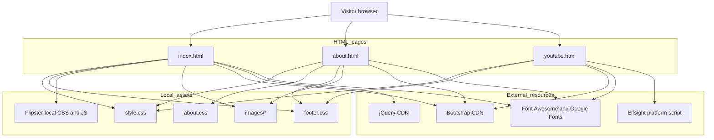
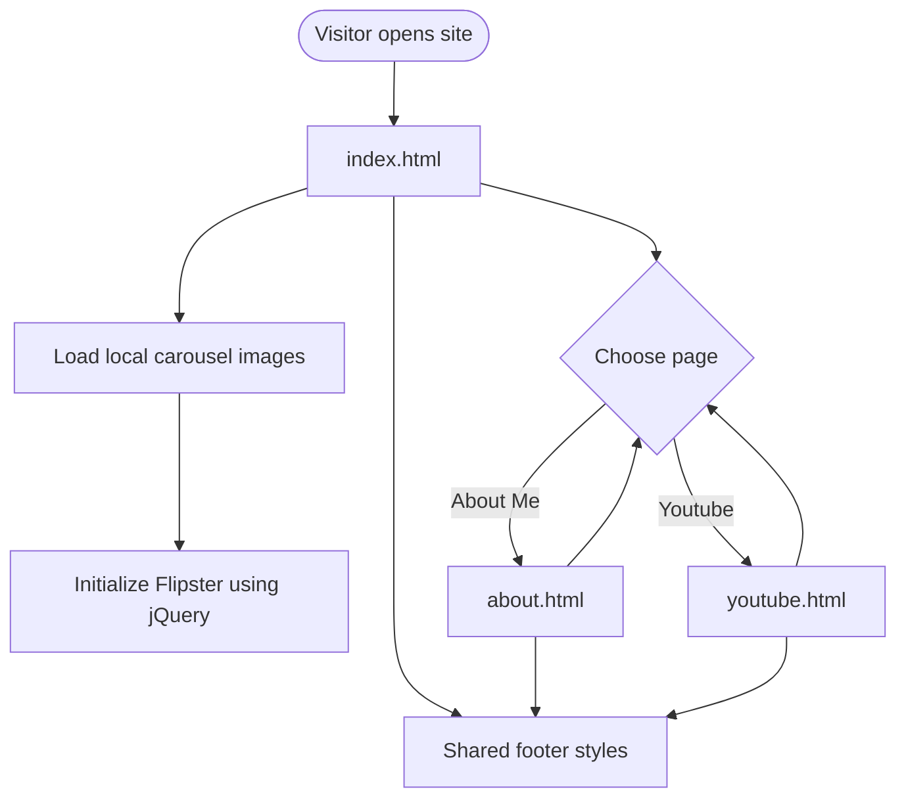

<div align="center">

# 🎨 Art Gallery

### A static multi-page gallery with a Flipster image carousel

[](https://github.com/Brajesh31/Art-Gallery/stargazers)
[](https://github.com/Brajesh31/Art-Gallery/network)
[](https://github.com/Brajesh31/Art-Gallery/issues)
[](LICENSE)

</div>

---

## 📌 Contents
- [🎯 Project overview](#-project-overview)
- [✨ Current pages and features](#-current-pages-and-features)
- [🧱 Architecture](#-architecture)
- [🔄 Navigation and runtime flow](#-navigation-and-runtime-flow)
- [🧰 Technology stack](#-technology-stack)
- [🗂️ Repository structure](#️-repository-structure)
- [🚀 Run locally](#-run-locally)
- [🖼️ Images and artwork](#️-images-and-artwork)
- [🌐 External dependencies](#-external-dependencies)
- [♿ Accessibility and responsive review](#-accessibility-and-responsive-review)
- [🧪 Validation](#-validation)
- [⚠️ Known limitations](#️-known-limitations)
- [🗺️ Roadmap](#️-roadmap)
- [📚 Documentation](#-documentation)
- [🤝 Contributing](#-contributing)

## 🎯 Project overview

Art Gallery is a small static website that presents a collection of local images in a dark visual layout. It includes a home gallery with a jQuery Flipster carousel, an About page, and a media-oriented page containing an Elfsight widget mount point.

The project intentionally uses plain HTML, CSS, and browser-side JavaScript. It does not require Node.js, npm, a bundler, or a server-side runtime. A static host can serve the repository root directly.

**Important distinction:** this repository is a static presentation site, not a full gallery-management platform. There is no backend, database, image upload flow, user account system, API, or content-management interface.

## ✨ Current pages and features

| Page or component | Current role | Notes |
|---|---|---|
| `index.html` | Home gallery | Displays ten local images through the Flipster carousel |
| `about.html` | About page | Shows profile image and descriptive content |
| `youtube.html` | Media page | Contains an Elfsight widget container and external platform script |
| `style.css` | Shared base styles | Page backgrounds and basic layout |
| `about.css` | About-page styles | Content, image, text and responsive layout |
| `footer.css` | Footer styles | Three-column footer layout with responsive stacking |
| `jquery.flipster.min.js` | Carousel behaviour | Locally stored minified Flipster library |
| `images/` | Image assets | Ten JPEGs and one PNG |

### Current feature boundary

- Static navigation between three HTML pages.
- Local image assets.
- Carousel styling and interaction through jQuery Flipster.
- Responsive navbar classes supplied by Bootstrap.
- Shared footer presentation.
- A third-party widget placeholder on the media page.

The search form visible in the original pages has no implemented search index or search endpoint. Placeholder social links are not working social destinations. The Elfsight mount point does not by itself prove that the widget is configured or active.

## 🧱 Architecture



## 🔄 Navigation and runtime flow



The diagram describes static page navigation and dependencies. It does not represent a backend workflow because none exists in the current repository.

## 🧰 Technology stack

| Technology | Purpose |
|---|---|
| HTML5 | Page structure and navigation |
| CSS3 | Dark visual theme, layout, footer and responsive rules |
| Bootstrap 5.1.3 | Navigation and layout utility classes |
| jQuery 3.6.0 | Runtime dependency for Flipster |
| jQuery Flipster | 3D-style carousel presentation |
| Font Awesome 4.2.0 | Footer icon glyphs |
| Google Fonts | Typography |
| Elfsight | External media widget integration point |

The current site loads some dependencies from public CDNs. Their uptime, privacy behaviour, content, and version support are external to this repository.

## 🗂️ Repository structure

```text
Art-Gallery/
├── .github/
│   ├── ISSUE_TEMPLATE/
│   ├── workflows/
│   └── PULL_REQUEST_TEMPLATE.md
├── docs/
│   ├── README.md
│   ├── project-overview.md
│   ├── project-structure.md
│   ├── architecture.md
│   ├── installation.md
│   ├── external-resources.md
│   ├── image-assets.md
│   ├── accessibility.md
│   ├── testing.md
│   └── limitations-and-roadmap.md
├── images/
│   ├── img1.jpg ... img10.jpg
│   └── sample.png
├── index.html
├── about.html
├── youtube.html
├── style.css
├── about.css
├── footer.css
├── jquery.flipster.min.css
├── jquery.flipster.min.js
├── README.md
├── CONTRIBUTING.md
├── SECURITY.md
├── CHANGELOG.md
├── ROADMAP.md
└── LICENSE
```

See [Project structure](docs/project-structure.md) for file responsibilities.

## 🚀 Run locally

### Prerequisites
- A modern browser.
- Python 3 or another static file server.
- Git if cloning the repository.

No build command or package installation is needed.

### Clone and serve

```bash
git clone https://github.com/Brajesh31/Art-Gallery.git
cd Art-Gallery
python -m http.server 8000
```

Open:
- Home: [http://localhost:8000/](http://localhost:8000/)
- About: [http://localhost:8000/about.html](http://localhost:8000/about.html)
- Media: [http://localhost:8000/youtube.html](http://localhost:8000/youtube.html)

Press `Ctrl+C` to stop the local server.

## 🖼️ Images and artwork

The repository currently contains ten JPEG images and one PNG image under `images/`. The home carousel references `img1.jpg` through `img10.jpg`, and the About page references `sample.png`.

The repository does not document verified creator, source, or redistribution rights for every existing image. Do not assume that an image is free to redistribute just because it is present in the repository. Review [Image assets and usage rights](docs/image-assets.md) before adding or republishing artwork.

## 🌐 External dependencies

The HTML pages load Bootstrap, jQuery, Font Awesome, Google Fonts, and an Elfsight platform script from external hosts. The local Flipster library remains stored in the repository.

The original pages include an HTTP Font Awesome URL. This can be blocked as mixed content when the site is hosted over HTTPS. Review all external URLs, version pinning, Subresource Integrity values, and third-party widget privacy before production distribution. Do not copy integrity hashes from unrelated versions.

See [External resources](docs/external-resources.md).

## ♿ Accessibility and responsive review

The About stylesheet has responsive breakpoints and the footer stacks its columns at narrower widths. The pages still need a full keyboard, screen-reader, contrast, image-alt, and carousel accessibility review. Empty alt attributes on existing images must be reviewed against the actual image content.

See [Accessibility](docs/accessibility.md).

## 🧪 Validation

The repository quality workflow checks local relative asset and link references in the HTML pages. Manual browser testing remains necessary for visual layout, external dependency loading, carousel interaction, keyboard access, and mobile behaviour.

```bash
python -m http.server 8000
```

Then open each page and inspect the browser console and Network panel. See [Testing](docs/testing.md).

## ⚠️ Known limitations

- No backend, database, API, user accounts, or upload flow.
- The visible search form is not implemented as a working search feature.
- Several social links are placeholders.
- The external media widget's live configuration is not verified by the repository.
- Image licensing and creator attribution are not established for every existing image.
- Some external resource URLs and dependencies require a security and maintenance review.
- The carousel and external widgets depend on browser-side scripts and provider availability.

## 🗺️ Roadmap

1. Correct placeholder search and social links.
2. Fix mixed-content resources and review CDN integrity.
3. Add meaningful alternative text and improve keyboard accessibility.
4. Document image sources, licenses, and attribution.
5. Validate links and local assets in CI.
6. Improve responsive and reduced-motion behaviour.
7. Consider search, image detail views, or content management only when there is a defined requirement.

See [ROADMAP.md](ROADMAP.md) and [Limitations and roadmap](docs/limitations-and-roadmap.md).

## 📚 Documentation

| Guide | Description |
|---|---|
| [Documentation index](docs/README.md) | All technical guides |
| [Project overview](docs/project-overview.md) | Scope, pages and feature boundary |
| [Project structure](docs/project-structure.md) | File and directory responsibilities |
| [Architecture](docs/architecture.md) | Page, asset and dependency diagrams |
| [Installation](docs/installation.md) | Local preview and editing workflow |
| [External resources](docs/external-resources.md) | CDN and third-party script review |
| [Image assets](docs/image-assets.md) | Artwork and attribution policy |
| [Accessibility](docs/accessibility.md) | Keyboard, image and responsive checks |
| [Testing](docs/testing.md) | Static and manual validation |
| [Limitations and roadmap](docs/limitations-and-roadmap.md) | Gaps and planned work |
| [FAQ](docs/faq.md) | Common questions |
| [Deployment](docs/deployment.md) | Static hosting |

## 🤝 Contributing

Read [CONTRIBUTING.md](CONTRIBUTING.md) before making changes. Preserve the static-site design unless a deliberate architecture change is proposed. Include validation evidence and update relevant documentation.

## 📄 License

MIT License. See [LICENSE](LICENSE).

## 👤 Maintainer

Brajesh Kumar · [@Brajesh31](https://github.com/Brajesh31)

---

⭐ If you find the project useful, consider starring the repository and reporting a concrete improvement.

Last updated: 2026-11-16 16:48 UTC
