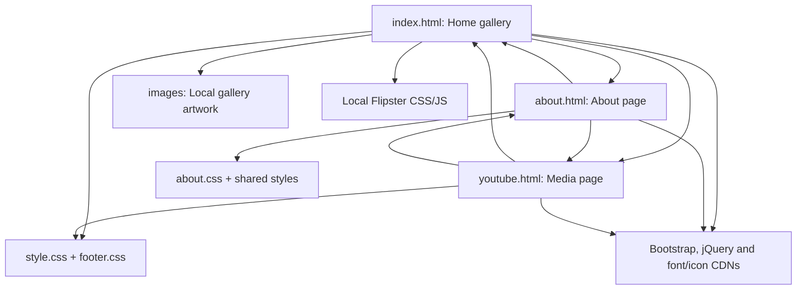

# 📚 Art Gallery documentation

This documentation describes the existing static website and its current constraints. The tracked project contains three HTML pages, local CSS, a locally bundled Flipster carousel library, local image assets, and third-party resources loaded from CDNs. It does not contain a backend, server-side API, database, authentication, package manager, or build pipeline.

## 🧭 Start here

| Goal | Guide |
|---|---|
| Understand scope and current capabilities | [Project overview](project-overview.md) |
| Understand pages, assets, and dependencies | [Architecture](architecture.md) |
| Understand file responsibilities | [Project structure](project-structure.md) |
| Run the site locally | [Installation](installation.md) |
| Understand CDN and external resource usage | [External resources](external-resources.md) |
| Manage images and usage rights | [Image assets](image-assets.md) |
| Review accessibility and responsive requirements | [Accessibility](accessibility.md) |
| Publish to static hosting | [Deployment](deployment.md) |
| Validate links, assets, and page structure | [Testing](testing.md) |
| Review known issues and future improvements | [Limitations and roadmap](limitations-and-roadmap.md) |
| Find answers to common questions | [FAQ](faq.md) |
| Understand repository structure | [Project structure](project-structure.md) |

## 🗺️ Site map

## 🧱 Documentation principles

1. Describe only behaviour present in the repository.
2. Do not describe placeholder search controls or external widgets as working features unless verified.
3. Use relative paths and preserve filename case.
4. Record image source and usage permission before redistributing artwork.
5. Keep external resources HTTPS-based and review their integrity attributes.
6. Do not commit personal data, private source files, secrets, or unlicensed images.
7. Keep Mermaid diagrams editable and update this index when guides change.

## 🏛️ Repository policies

- [Contributing](../CONTRIBUTING.md): branch, code, accessibility, and asset rules.
- [Security policy](../SECURITY.md): dependency, embed, and private reporting guidance.
- [Governance](../GOVERNANCE.md): project stewardship and decision principles.
- [Accessibility statement](../ACCESSIBILITY.md): site accessibility expectations.
- [Release process](../RELEASE.md): validation and rollback.
- [Maintainers](../MAINTAINERS.md): repository ownership and responsibilities.
