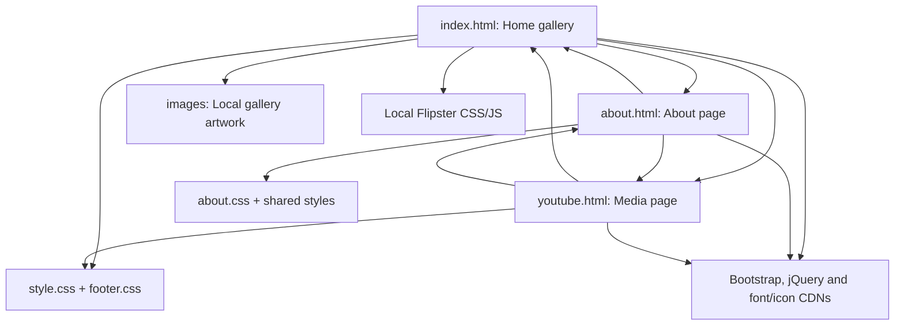

# 📚 Art Gallery documentation

This documentation describes the existing static website and its current constraints. The project contains three HTML pages, local CSS, a locally bundled Flipster carousel library, local artwork, and third-party resources loaded from CDNs. It does not contain a backend, server-side API, database, authentication, package manager, or build pipeline.

## 🧭 Documentation map

| Area | Guides |
|---|---|
| Project scope and experience | [Project overview](project-overview.md), [Usage](usage.md), [Demo](demo.md), [Requirements](requirements.md), [User stories](user-stories.md), [Acceptance criteria](acceptance-criteria.md) |
| Architecture and decisions | [Architecture](architecture.md), [Diagrams](diagrams.md), [Project structure](project-structure.md), [Decision records](decisions/README.md) |
| Setup and development | [Installation](installation.md), [Configuration](configuration.md), [Development](development.md), [Commands](commands.md) |
| Design and content | [Design system](design-system.md), [Content model](content-model.md), [Content guidelines](content-guidelines.md), [Image assets](image-assets.md), [Asset inventory](asset-inventory.md) |
| Dependencies and security | [Dependency register](dependency-register.md), [External resources](external-resources.md), [Privacy](privacy.md), [Threat model](threat-model.md), [API status](api.md), [Database status](database.md) |
| Accessibility and quality | [Accessibility](accessibility.md), [Accessibility testing](accessibility-testing.md), [Compatibility](compatibility.md), [Performance](performance.md), [SEO](seo.md), [Testing](testing.md), [Testing matrix](testing-matrix.md), [Error handling](error-handling.md) |
| Hosting and operations | [Deployment](deployment.md), [Hosting checklist](hosting-checklist.md), [Operations](operations.md), [Observability](observability.md), [Maintenance](maintenance.md), [Disaster recovery](disaster-recovery.md) |
| Support and limitations | [FAQ](faq.md), [Troubleshooting](troubleshooting.md), [Glossary](glossary.md), [Limitations and roadmap](limitations-and-roadmap.md) |

## 🗺️ Site map

## 🖼️ Visual documentation

- [Project banner](../assets/art-gallery-banner.svg)
- [Architecture overview](../assets/architecture-overview.svg)
- [Visitor journey](../assets/visitor-journey.svg)
- [Artwork publishing flow](../assets/artwork-publishing-flow.svg)

## 🏛️ Repository policies

- [Contributing](../CONTRIBUTING.md)
- [Security policy](../SECURITY.md)
- [Governance](../GOVERNANCE.md)
- [Accessibility statement](../ACCESSIBILITY.md)
- [Release process](../RELEASE.md)
- [Maintainers](../MAINTAINERS.md)

## Documentation principles

Describe only implemented behaviour. Label proposals as proposals. Do not invent image provenance, deployed demo URLs, screenshots, test results, API endpoints, or database schemas. Update this index when guides change.
