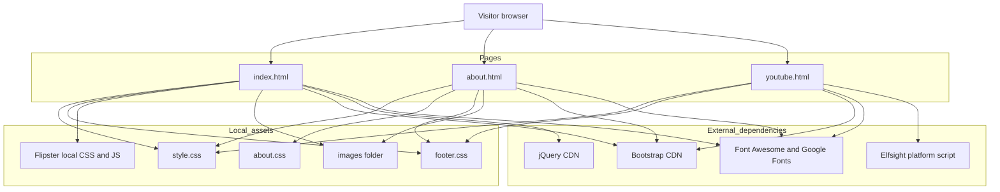
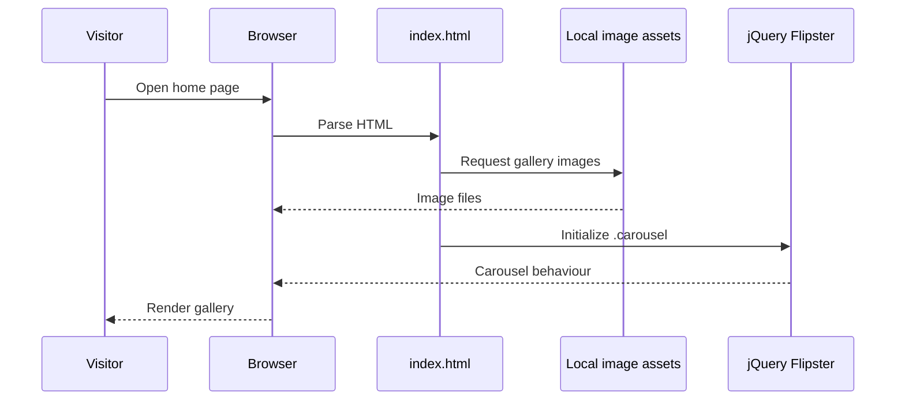

# 🏛️ Static-site architecture

## Architectural style
Art Gallery is a browser-rendered static multi-page website. The browser opens an HTML document, downloads linked stylesheets and scripts, loads local images, and runs client-side carousel initialization where configured. There is no application server, database, API, account system, or build process in the tracked tree.

## Component diagram

## Home-page carousel flow

## Page responsibilities
- **Home:** presents the image collection and initializes Flipster on the carousel element.
- **About:** presents descriptive text and a local profile image.
- **Media:** contains an Elfsight mount point and platform script.

## Dependency boundaries
HTML pages use relative paths for local CSS, JavaScript, and images. Bootstrap, jQuery, Font Awesome, Google Fonts, and Elfsight are external runtime dependencies. If a CDN or provider is unavailable, some presentation or widget behaviour may degrade.

## Operational implications
- Static hosting is sufficient.
- CDN availability and provider-side changes can affect runtime behaviour.
- A restrictive Content Security Policy must allow required sources or external resources will fail.
- Local image paths must preserve filename case.
- Browser-delivered source is public. Do not add secrets to HTML or JavaScript.
