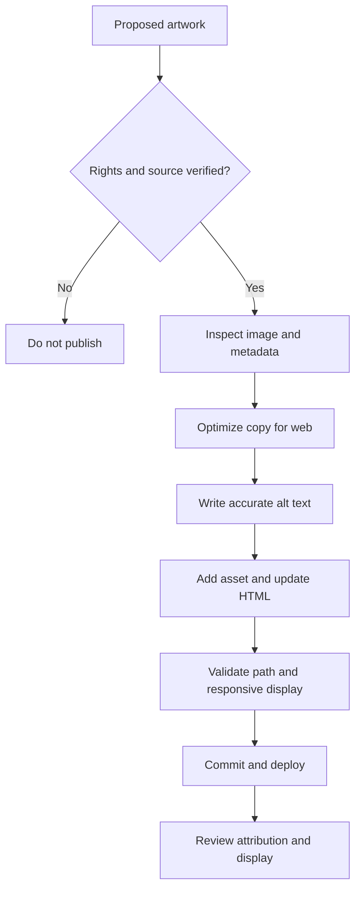

# 🖼️ Artwork content model

## Current implementation

The current gallery is hard-coded in the HTML. Each image is referenced by a local path. The repository does not contain a structured artwork catalogue or verified metadata for every image.

## Recommended metadata record

| Field | Required | Description |
|---|---|---|
| `asset_path` | Yes | Repository-relative image path |
| `display_title` | Recommended | Verified title of the work |
| `creator` | Recommended | Artist/photographer, only when known |
| `description` | Optional | Short editorial context |
| `alt_text` | Yes for informative image | Accessible visual description |
| `source_url` | Required for externally sourced content | Original source or creator page |
| `license` | Required | Permission or license basis |
| `attribution` | As required | Exact required credit |
| `width` / `height` | Recommended | Intrinsic dimensions |
| `file_size` | Recommended | Asset transfer size |
| `reviewed_on` | Recommended | Date provenance was checked |

## Content workflow

## Editorial rules

- Do not invent a title, creator, location, or historical context.
- Do not treat the filename as proof of provenance.
- Do not remove required attribution.
- Do not publish images with unclear redistribution rights.
- Avoid sensitive or unnecessary EXIF metadata.
- Keep the displayed image and its alt text consistent.

## Future catalogue

A JSON manifest could eventually make the gallery easier to maintain, but no manifest loader exists today. Introducing one should include schema validation, safe rendering, fallback behaviour, and tests.
