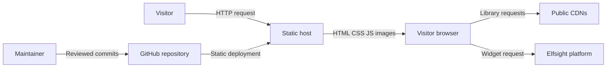
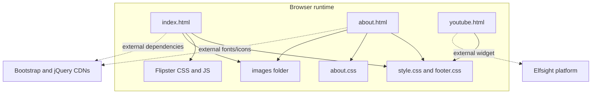
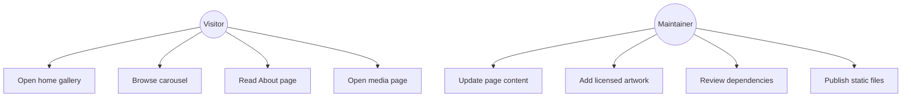
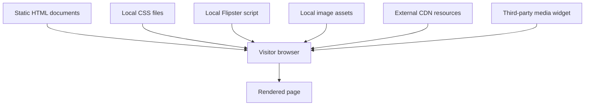
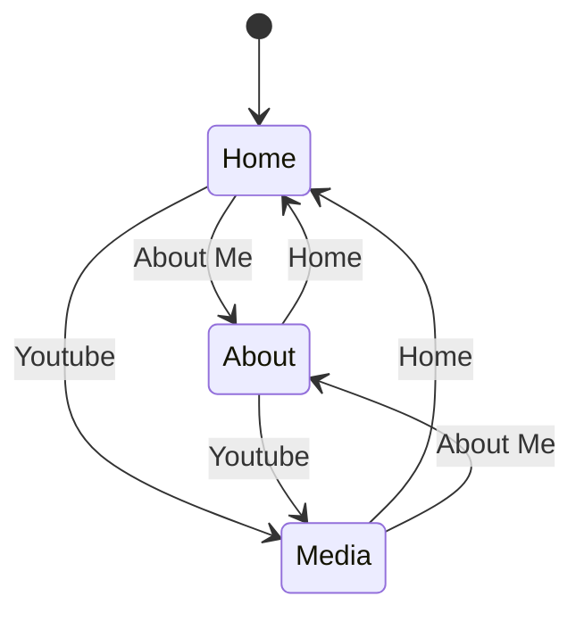
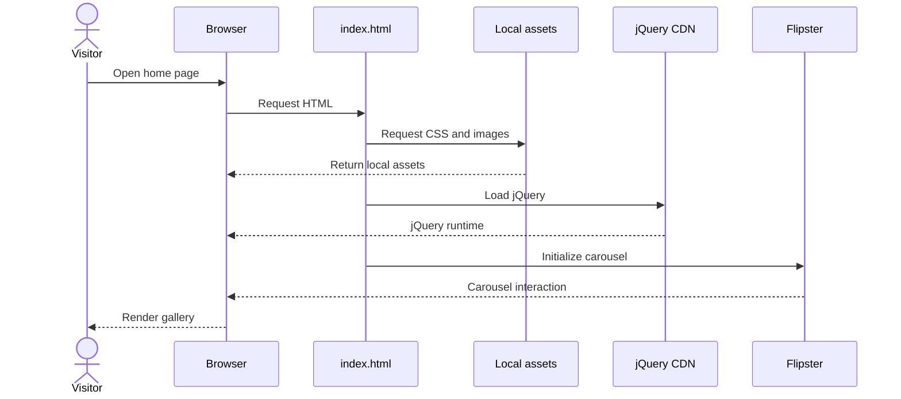
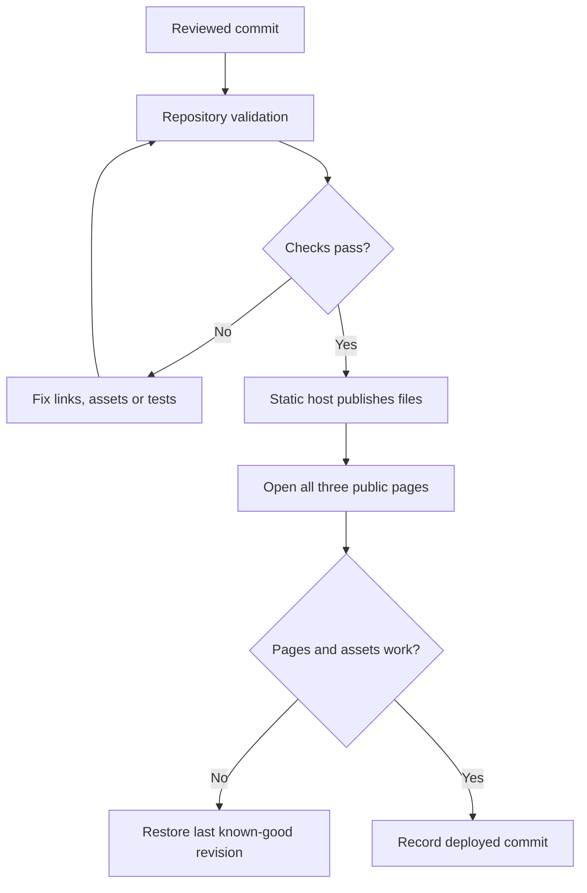
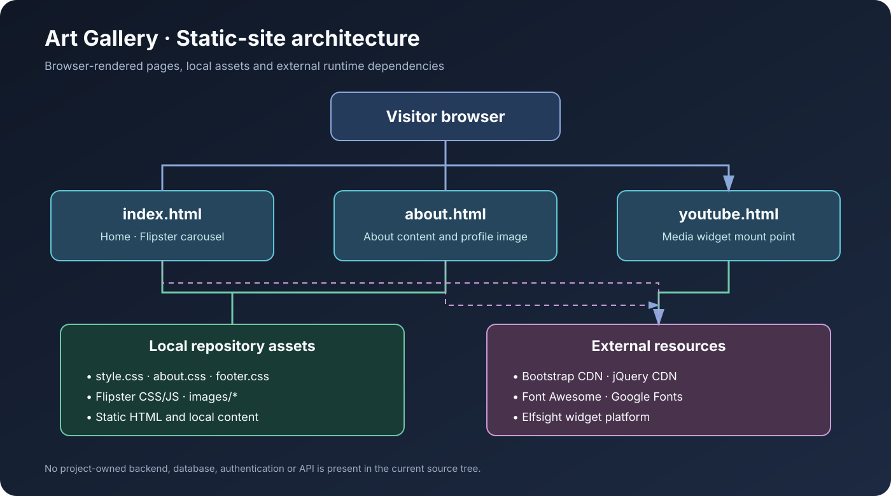
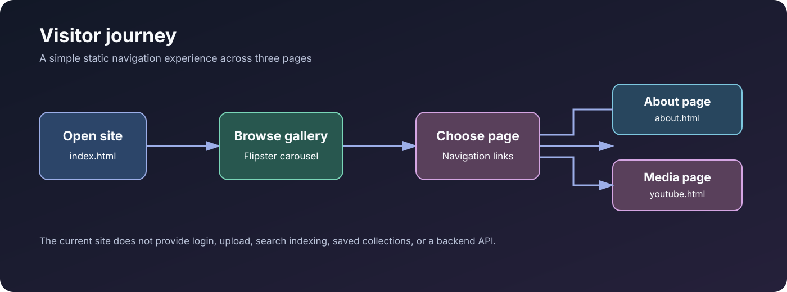
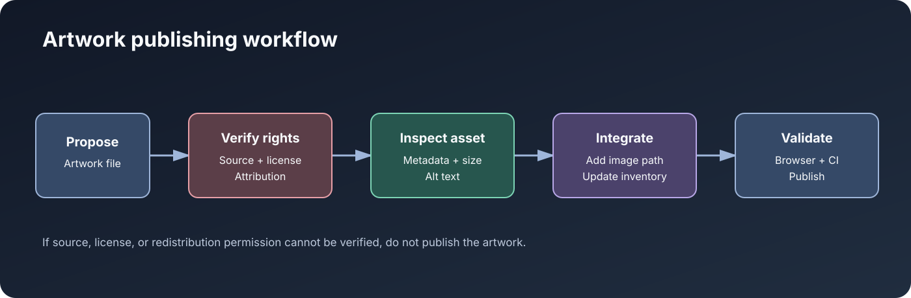

# 🧩 System diagrams

This page is the editable diagram catalogue. Diagrams describe the current repository unless a section is explicitly marked as a future proposal.

## 1. System context diagram

## 2. Component diagram

## 3. Use-case diagram

## 4. Data-flow diagram

No first-party visitor data store or backend process is represented because none exists in the current repository.

## 5. Page-navigation state diagram

## 6. Home-page loading sequence

## 7. Static deployment flow

## 8. Data model and ER diagram status

An entity-relationship diagram is not applicable to the current implementation. There is no database, persistent application data, or structured artwork catalogue. The proposed artwork metadata fields are documented in [Content model](content-model.md), but they are not a live database schema.

## 9. API diagram status

There is no project-owned API. The pages request static files and external third-party resources. Do not draw endpoints or request/response schemas as implemented until an API is introduced and verified.

## 10. Visual SVG assets

- 
- 
- 

## Diagram maintenance

- Keep Mermaid source editable in Markdown.
- Label external providers and trust boundaries.
- Do not show an API/database that is not implemented.
- Update diagrams when pages, scripts, or assets change.
- Verify diagrams render in GitHub before release.
