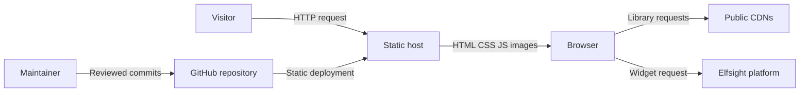
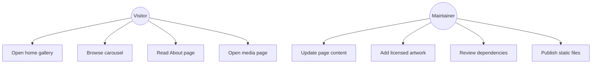
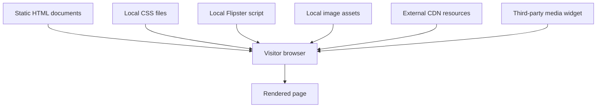
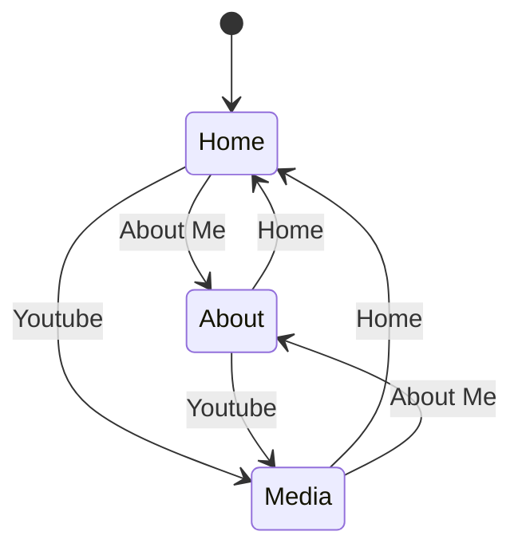
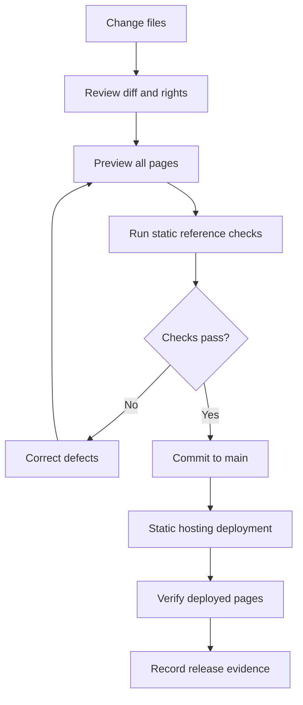

# 🧩 System diagrams

This page is the diagram index. All diagrams must describe the current repository accurately. A future capability must be labeled as proposed, not implemented.

## 1. System context

## 2. Use-case view

## 3. Data-flow view

No first-party visitor data store or backend process is represented because none exists in the current repository.

## 4. Page-navigation view

## 5. Release workflow

## Diagram maintenance

- Keep Mermaid syntax in fenced code blocks.
- Label external providers and trust boundaries.
- Do not show an API/database that is not implemented.
- Update diagrams when pages, scripts, or assets change.
- Verify diagrams render in GitHub before release.
