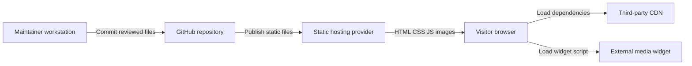

# 🛡️ Threat model

## Scope and assumptions

This is a lightweight threat model for the current static website. It covers browser-delivered code, third-party resources, local assets, and the deployment boundary. It does not describe a backend because no backend exists in the repository.

## Assets to protect

- Repository integrity and maintainer access.
- Visitor browser integrity while viewing the site.
- Correct and authorized artwork.
- Public content accuracy.
- External dependency and widget trust boundaries.
- Any future private configuration or credentials.

## Trust boundaries

## Threat register

| Threat | Likely impact | Current mitigation / required action |
|---|---|---|
| Malicious or compromised CDN script | Script executes in page context | Pin versions, review provider, use correct integrity metadata where possible |
| Mixed-content resource | Resource blocked or insecure transport | Use HTTPS and verify every URL |
| Secret committed to public source | Credential exposure | Never place secrets in browser-delivered files; rotate exposed credentials |
| Unlicensed artwork | Takedown or legal dispute | Record creator, source, permission, and attribution |
| Malicious image metadata | Privacy leakage | Strip unnecessary EXIF metadata from new images |
| Compromised maintainer account | Unauthorized repository changes | Enable strong account security and review access |
| Third-party widget tracking | Unexpected visitor data processing | Review provider behaviour, consent, and privacy notice |
| Broken path or hostile replacement asset | Page degradation or misleading content | Review changes and validate paths/assets in CI |

## Security controls to prioritize

1. Keep repository permissions limited to trusted maintainers.
2. Review dependency updates and external script changes.
3. Keep workflows on least-privilege permissions.
4. Validate HTML/CSS references in CI.
5. Use HTTPS for every external resource.
6. Keep image provenance and usage rights documented.
7. Review deployed security headers with the hosting provider.
8. Never add a backend secret to the static repository.

## Residual risk

Static hosting reduces server-side attack surface but does not make the site risk-free. A compromised CDN, external widget, repository account, or hosting account can still affect visitors. Revisit this model whenever new scripts, forms, uploads, or user data are introduced.
